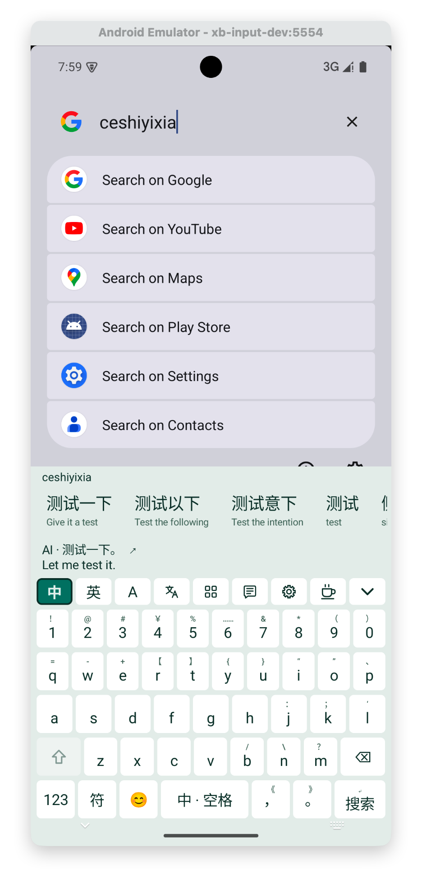
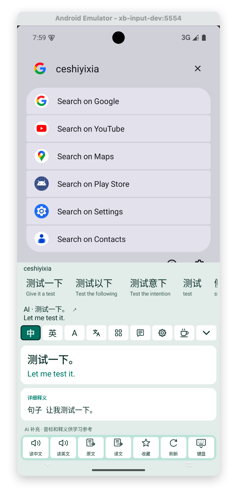

# 简语输入法

**中文输入，顺便学点英语。**

一款免费的 Android 输入法，支持离线拼音、英文补全、双语候选和 AI 翻译。无需注册账号，基础输入可以离线使用。

本仓库用于分发安装包和使用说明，不包含应用代码。

[下载安装包](https://github.com/huisedediao/jianyu_input/releases/download/v0.1.3-20261012-ai-top/jianyu-input-0.1.3.apk) · [查看所有版本](https://github.com/huisedediao/jianyu_input/releases)

## 下载与安装

当前版本：**0.1.3**，更新日期：**2026-10-12**。

- 系统要求：Android 8.0 或更高版本。
- 支持架构：ARM64、x86_64。
- 安装包同时保存在本仓库的 [packages](packages/) 目录和 GitHub Releases 中。
- Release 附带 `SHA256SUMS`，可用于校验安装包。

1. 下载上方 APK，或前往 [Releases](https://github.com/huisedediao/jianyu_input/releases) 下载附件。
2. 打开 APK 安装；如果系统询问，允许当前浏览器或文件管理器安装应用。
3. 打开「简语输入法」，点击「① 启用输入法」，在系统设置中启用简语。
4. 点击「② 切换到简语」，选择简语输入法。
5. 在试打框输入 `nihao`，体验中文候选和英文释义。

## 主要功能

- **三种输入模式**：中（拼音）、英（英文补全）、A（字母直输）。
- **双语候选**：中文候选搭配英文释义，英文候选搭配中文释义。
- **AI 翻译与词典详情**：翻译当前文本，补充释义、音标和例句；支持系统语音朗读和生词收藏。
- **更多候选**：展开为四列网格，上下滑动浏览，单击输入原文，长按查看详情。
- **常用语与快捷短语**：两套独立列表。常用语直接点选输入；快捷短语通过自定义缩写调用，均不预置内容。
- **快捷符号**：部分字母、数字和标点支持上滑或长按输入上方标注的符号。
- **光标移动**：按住空格上下左右滑动，同一次按住期间可以连续转向，例如先上再左。
- **换行**：最右下角的操作键长按或上滑换行；中文模式下有未确认字母时，短按先输入字母。
- **外观与反馈**：支持浅色、深色、键高、震动强度和按键音量设置。普通候选、AI 候选与展开网格的点击和长按均支持震动，普通候选和 AI 候选上下滑动确认时也支持震动，沿用键盘的震动开关和强度。

AI 整句结果显示在输入法最顶部，原文和译文各占一行，长内容省略；结果出现、更新或消失时，普通候选行、工具栏和键盘的位置保持不变。

普通候选栏与 AI 整句栏：单击输入原文，上滑输入译文，下滑或长按打开详情。展开网格的上下滑动只滚动列表，避免翻页时误输入译文。

## 界面展示

| 键盘与双语候选 | 双语详情 |
| :---: | :---: |
|  |  |

## AI 设置与数据说明

基础输入无需 AI。需要翻译、详细释义或云联想时，在设置中选择厂商，填写自己的 API Key、模型名称和 HTTPS 接口地址，保存后测试连接。支持 DeepSeek 等兼容接口。

- AI 功能按设置将相关文本直接发送到你选择的服务商；开启上下文选项后，云联想还会使用光标附近的文字。
- API Key 在本机加密保存；服务费用由所选厂商及你的账户决定。
- 常用语、快捷短语、学习记录和收藏保存在本机。
- 私密输入不联网、不学习。
- 朗读使用手机的系统语音服务，需要安装可用的中文或英文语音包。

## 支持作者 ☕️

**免费软件，用爱发电，如果对你有帮助，可以请我喝个水～**

键盘工具栏中，设置图标右侧的咖啡杯按钮可以打开收款码面板。点击图片可查看大图，点击「保存到相册」可保存原图。支持完全自愿，不影响任何输入功能。

| 支付宝 | 微信 |
| :---: | :---: |
|  |  |
| [查看 / 保存原图](images/alipay.jpg) | [查看 / 保存原图](images/wechat.png) |

## 反馈与源码

遇到问题可以在 [Issues](https://github.com/huisedediao/jianyu_input/issues) 中反馈，并附上手机型号、Android 版本、应用版本和复现步骤。请勿提交 API Key 或其他私密内容。

简语基于 [Qingjian](https://github.com/qingjian-team/qingjian) 开发，采用 GPL-3.0-or-later 许可。许可正文见 [LICENSE](LICENSE)。
